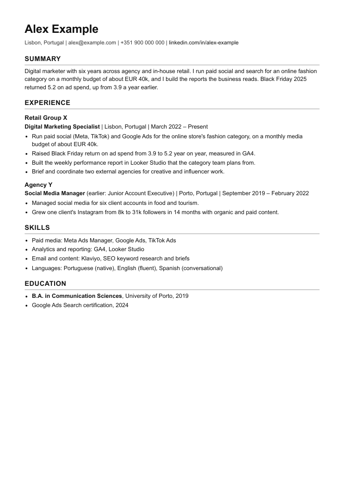
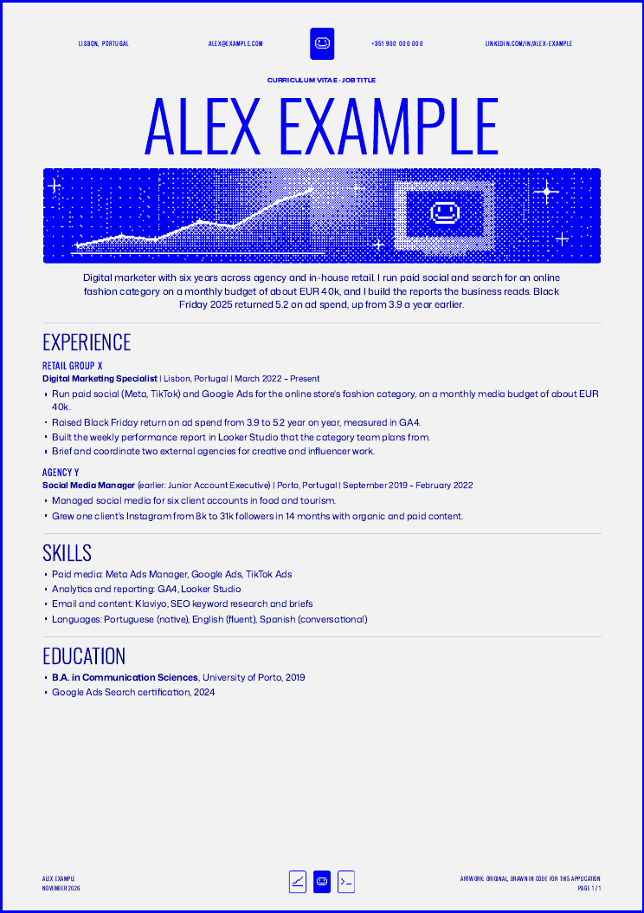

# Job search agent

Turn [Claude Code](https://claude.com/claude-code) into a partner for your job search. No programming needed: you talk, it works.

It will:
1. **Grill your CV.** It reads your current CV, asks you hard questions one at a time, and rewrites it using only what you confirm is true.
2. **Prepare each application.** Send it a job link. It tells you honestly how well you fit, then writes a tailored CV, a cover letter, the answers for the form, and short notes to people who could open a door.
3. **Style it like the company.** On request it restyles your CV and letter in the company's own look: their colours, type and layout, with original artwork.
4. **Keep track.** A simple dashboard of everything you sent and what happened, and a running list of what your own search is teaching you.

It never sends anything for you, and it never writes anything about you that you haven't confirmed.

| Plain CV (what résumé software reads) | Styled CV (what a person remembers) |
|---|---|
|  |  |

_Both are a fictional person. The styled one is the starting template; `/brand-cv` redesigns it for each company._

## Start in three steps

You need the Claude Code desktop app (or Claude Code in a terminal) and, for the PDFs, Google Chrome (or Edge, Brave or Arc).

**1. Paste this into Claude Code:**

```text
Download https://github.com/diogodebastos/job-search-agent into my Documents folder
(use git clone, or download and unzip the zip from GitHub if git is not installed).
Then read the CLAUDE.md file inside it and follow the "start" skill at
.claude/skills/start/SKILL.md to set me up. I'm not a programmer, so please
explain things simply and do the technical steps yourself.
```

**2. Answer its questions.** It checks your computer, asks for your contact details and what kind of job you want, then asks for your current CV. Drag the file into the chat.

**3. Next time, open the folder.** In the Claude Code app, start a new session and choose the `job-search-agent` folder in Documents. Then you can use the short commands below.

## What to say

| You want to | Say |
|---|---|
| Set up, the first time | `/start` |
| Make your CV much better | `/grill-cv` (or just drag your CV into the chat) |
| Apply to a job | paste the job link (or `/apply <link>`) |
| Find openings at a company | `/apply find Nestlé marketing` |
| Record what happened | `/apply update Nestlé they invited me to an interview` |
| Style the CV like the company | `/brand-cv` |
| See everything at a glance | `/tracker` |
| Step back and learn | `/apply retro` |

You can also just talk: "what do you think of this job?", "they rejected me", "help me prepare for Thursday's interview".

## Your data stays yours

Everything about you (your CV, your facts, your applications, your pay floor) is kept in a folder called `my/` inside this one, on your computer. It is excluded from git, so it is never uploaded with the project. Claude reads it to do the work; conversations with Claude are covered by your Claude account's own privacy settings.

## How it works

- **A facts file.** `/grill-cv` records everything you confirm as a numbered fact, plus a list of things you have *not* done. Every line of every CV and letter must trace back to a fact. This is what keeps it honest when it is trying to make you look good.
- **A master CV.** Everything true and worth saying, in a plain format software can read. Each application's CV is cut from it.
- **One folder per application**, holding the posting, the analysis and fit score, the CV and letter, the form answers and the outreach notes.
- **Learnings.** [`LEARNINGS.md`](LEARNINGS.md) holds what an earlier real job search taught (the short version: who you know matters more than how the CV reads, so look for a way in before you apply). Your own results are added to `my/learnings.md` and take priority.
- **Market notes.** [`markets/`](markets) has local habits per country. Portugal is there; add yours.

## For the curious

```
CLAUDE.md               rules Claude follows in this folder
LEARNINGS.md            what earlier searches taught
.claude/skills/         start, grill-cv, apply, brand-cv, tracker
scripts/                render.mjs (PDFs + checks), tracker.mjs, study-site.mjs, fetch-fonts.mjs
templates/              the plain CV style and an example profile
markets/                country notes
my/                     your private workspace (created by /start, never shared)
```

The scripts use Node 18+ with no packages to install, and any Chromium-based browser to print PDFs. Improvements and new market notes are welcome as pull requests. Never include anything from a `my/` folder.

## Licence

MIT. Built by [Diogo de Bastos](https://diogodebastos.com) from his own job search, with Claude Code.
